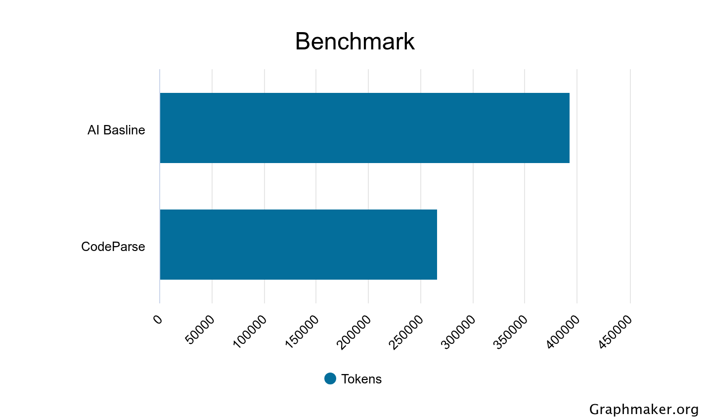

<h1 align="center">CodeParse</h1>

  
  
  

CodeParse is a codebase indexer that gives agents fast, accurate, and compact context on your Python codebases while reducing token usage. It parses your codebase and stores the relationships of your code in a local SQLite database.

  
   
  <small>See the <a href="#benchmark-evaluation">Benchmark Evaluation</a> section for more details.</small>

## Install MCP Server and Skill

1. Put the `codeparse` binary on your PATH (release asset or `make compile` → `dist/codeparse`).
2. `codeparse install`

## Tools

| Tool | Description |
| --- | --- |
| `get_project_overview` | Return the largest directories and the project entry points. |
| `get_directory_tree` | Return the directory tree. |
| `get_file_symbols` | Return the symbol tree of one file. |
| `get_file_imports` | Return the import statements of one file. |
| `get_symbol` | Return one symbol's definition and its reference counts. |
| `get_symbol_at_lines` | Return the symbol that covers a line range in a file. |
| `get_symbol_references` | Return the call, access, and type-annotation sites for one symbol. |
| `search_symbols` | Full Text Search symbol names. |
| `list_subclasses` | Return the classes that directly inherit from a class. |
| `list_importers` | Return the files that import a module. |

## Commands

| Command | Description |
| --- | --- |
| `install` | Register the MCP server in installed clients and write the skill. |
| `uninstall` | Remove the MCP server and skill. |
| `update` | Replace the binary with the latest release and update the skill. |
| `mcp` | Start the MCP server. |
| `reload` | Drop the index and reprocess the workspace ad-hoc |

## Benchmark Evaluation

In-Progress

Ten questions found in `eval/tasks.json` are evaluated against the [SQLMesh](https://github.com/TobikoData/sqlmesh) repo using a baseline agent and an agent with the CodeParse MCP server.

| Model | Baseline Avg Tokens | CodeParse Avg Tokens | Token Reduction |
| --- | --- | --- | --- |
| Grok 4.7 High Fast | 393,530 | 265,867 | -32% |
| Opus 5.5 Medium | ... | ... | ... |

## Running the Evaluation

Cursor Default Model: `grok 4.7`  
Claude Defualt Model: `opus 5.5 medium`

 - `make eval-smoke cursor` will run all 10 questions and evaluate.
 - `make eval cursor` will run all 10 questions on repeat (10 times) and evaluate. 

